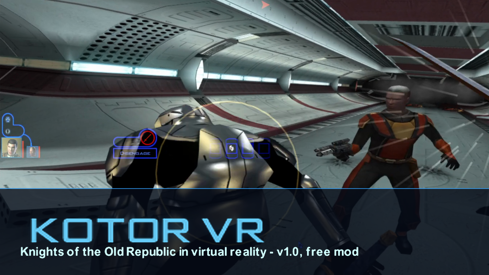

# KotOR VR

**Star Wars: Knights of the Old Republic in virtual reality** — an unofficial fan mod for the PC game (Steam), played
seated or standing with tracked controllers.

- **First person, in the game's own engine:** your head drives KotOR's camera, the world is rendered for each eye, and
  cutscenes stay in your character's eyes whenever you can see what the scene shows.
- **Physical combat:** your lightsaber or vibroblade hits what it actually touches; block and parry incoming blows
  with the blade; deflect blaster bolts back at the shooter; aim blasters with your hand.
- **Force powers by gesture:** gather the Force in your hand, then push, lift, hold or unleash lightning.
- **Your hands are your character's** (gloves, skin and outfit), holding your real equipped weapons.
- **Conversations, menus and the HUD in VR:** replies floating in front of the speaker, every line captioned, game
  screens on a panel, the HUD on your wrist.

KotOR's own rules still run underneath: your character's skills, feats, Force points and the d20 decide how well
what you do lands.

[](https://github.com/SeantheBomb/KotorVR/releases/download/v1.0.0/KotorVR_trailer_v1.mp4)

**▶ [Watch the trailer](https://github.com/SeantheBomb/KotorVR/releases/download/v1.0.0/KotorVR_trailer_v1.mp4)** · **[Download v1.0.0](../../releases/latest)** · **[How to play](docs/USER_GUIDE.md)** ·
**[Report a bug](../../issues/new?template=bug_report.yml)** · **[Suggest a feature](../../issues/new?template=feature_request.yml)**

> **v1.0 — a fan project made by one person.** It plays from the first room of the Endar Spire through Taris and
> beyond; tell me what breaks and what feels great. Read [Known issues](docs/KNOWN_ISSUES.md), and keep a backup of
> your saves.

## Requirements

- **Star Wars: Knights of the Old Republic** (the 2003 PC game) **on Steam**, Windows 10 or 11. Other versions (GOG,
  disc, patched executables) aren't supported yet: the mod checks the game's code and stays switched off if it
  doesn't match.
- **A PC VR headset with an OpenXR runtime.** Developed and tested on **Meta Quest 3 over Air Link** (Meta Quest Link
  app). Other Quests over Link / Air Link should work; SteamVR headsets are untested.
- Tracked motion controllers (Touch controllers or similar).
- A GPU that runs PC VR. Developed on NVIDIA; AMD and Intel are untested.

## Install

1. Download `KotorVR-<version>.zip` from the [Releases](../../releases) page and unzip it anywhere.
2. Run **`KotorVR-Setup.exe`**. It finds your KotOR folder (or browse to the folder with `swkotor.exe`), checks the
   game version and your VR runtime, then press **Install**. It takes a minute or two: the VR weapon models, hands,
   icons and sounds are built from **your own game files** on your PC.
3. A **KotOR VR** shortcut appears on your desktop and in the Start menu.

To remove the mod, run the setup again and press **Uninstall**: your game goes back to the original (your settings are
kept as `kvr.ini.kvr-saved`).

## Play

1. Connect your headset to the PC (Quest: start **Air Link** or plug in **Link** from the headset's Quick Settings).
2. Start **KotOR VR** from the shortcut: it starts the VR host, then KotOR through Steam.
3. In the game's menus, point with your right controller and pull the trigger to click.
4. Press the **right thumbstick** to recenter whenever your view drifts.

The [User guide](docs/USER_GUIDE.md) has every control, how combat and the Force work, all settings and
troubleshooting.

### The 30-second version

| | |
|---|---|
| Look, walk | your head; left stick (right stick turns, click it to recenter) |
| Use, talk, open, attack | point with your right hand, **right grip** |
| Click in menus and conversations | point, **right trigger** |
| Swords and sabers | swing for real — cut while the enemy's chest shows a **gold ring**; block its blows on the glowing bar |
| Blasters | point and pull the trigger — the **white-hot burst** is damage |
| The Force | hold the **left grip**, then shove, lift, hold or squeeze the left trigger, and let go |
| HUD, map, party | turn your **left palm** toward your face |

## Feedback

This is v1 and I want to hear how it plays.

- 🐞 **Bugs:** [open a bug report](../../issues/new?template=bug_report.yml) — attach `<KotOR>\kvr\probe.log` and a
  clip if you can.
- 💡 **Ideas:** [request a feature](../../issues/new?template=feature_request.yml).
- 💬 **Impressions, questions, clips:** [Discussions](../../discussions).

## Documentation

- [User guide](docs/USER_GUIDE.md) — setup, controls, combat, Force powers, settings, troubleshooting
- [Known issues](docs/KNOWN_ISSUES.md)
- [Changelog](CHANGELOG.md)

## Building from source

Windows, Visual Studio 2022 (C++ desktop workload), Python 3.11+ with Pillow, and the OpenXR SDK in
`third_party/openxr-1.1.65`.

```
game\build.bat                    the mod (dinput8.dll, 32-bit)
host\build.bat                    the VR host (kvr_host.exe, 64-bit OpenXR)
host\launch_build.bat             the launcher
installer\build_installer.ps1     everything above + KotorVR-Setup.exe and dist\KotorVR-<version>.zip
```

`docs/FINDINGS.md` documents the reverse-engineered engine internals the mod relies on; `docs/TESTING.md` the
automated test harness.

## Credits

- **Lane's KotOR 1 Ghidra project** (Deadly Stream) — the function and class names that made the animation, GUI and
  combat hooks possible.
- **OpenXR** (Khronos Group) — the VR runtime interface; `openxr_loader.dll` is Apache-2.0.
- Design references: Dr. Beef's **JKXR** (Jedi Knight VR), **d2r-pcvr** (Diablo II VR), Schell Games' *Until You Fall*
  GDC talk, Camouflaj's *Batman: Arkham Shadow*.
- The KotOR modding community (Deadly Stream, KotOR.js, reone, xoreos) for years of file-format and engine knowledge.

## License and disclaimer

The mod's code is released under the [MIT License](LICENSE).

KotOR VR is an unofficial fan project, not affiliated with or endorsed by Lucasfilm, Disney, BioWare, Aspyr or
Electronic Arts. Star Wars: Knights of the Old Republic and all related content are the property of their owners. The
mod contains no game files: you need your own copy of the game, and everything the mod shows is built from it on your
PC.
